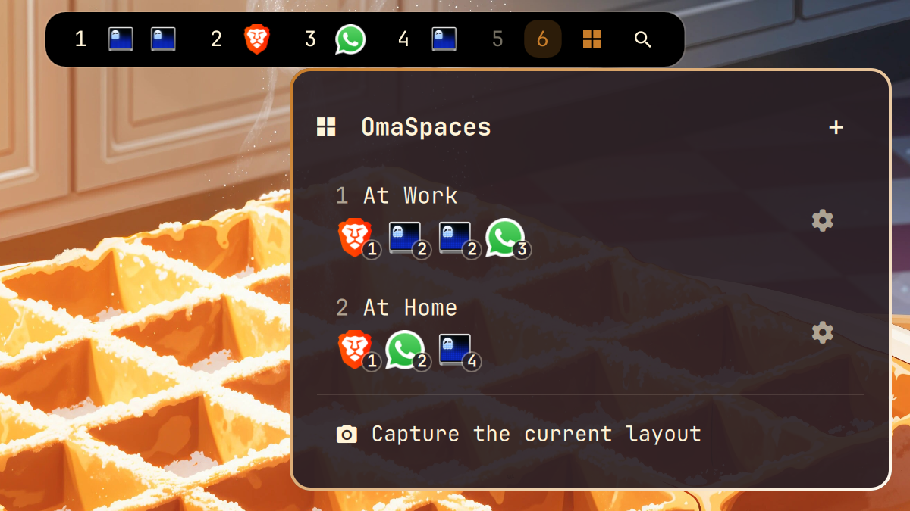
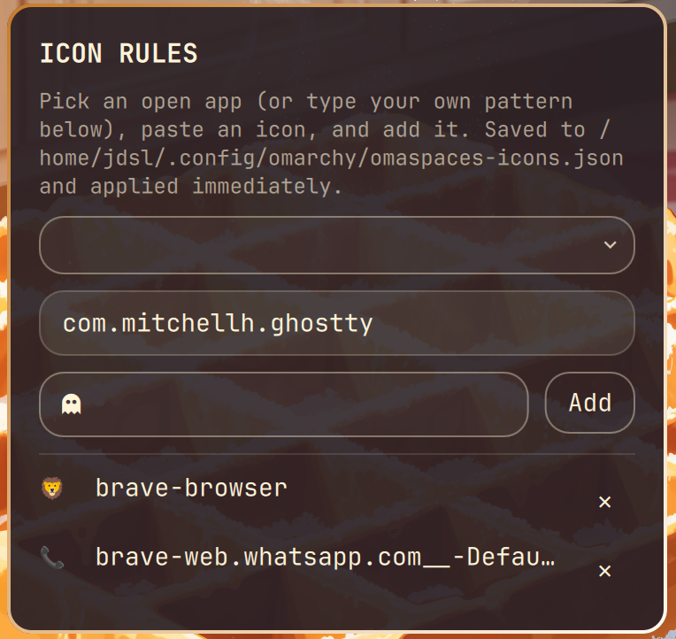
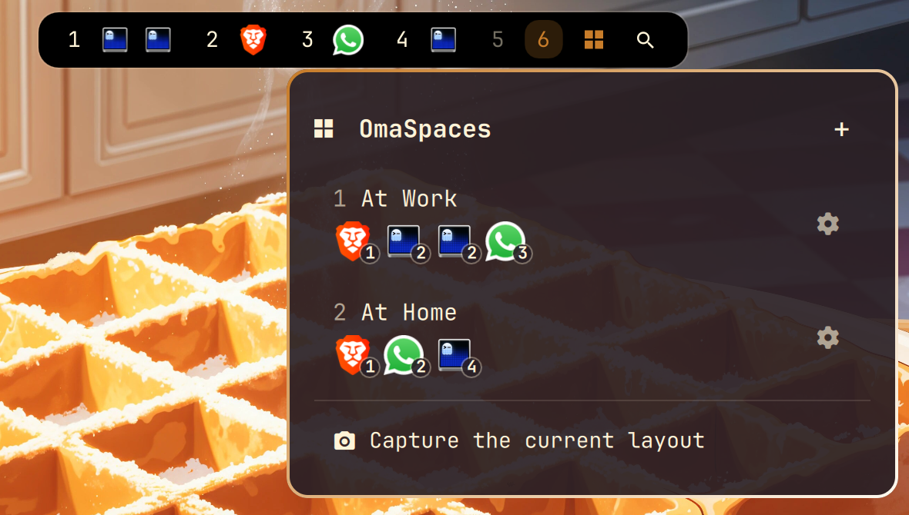
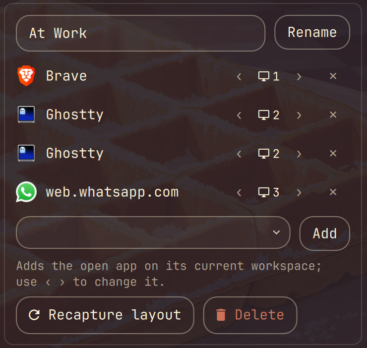

# Omaspaces

Workspace indicators for the [Omarchy](https://omarchy.org/) bar. Each pill shows the workspace number, an optional name, and the app icon of every open window. Right-click an icon to move or close its window, and save app layouts as profiles you can relaunch in one click.



## Usage


| Target | Left click | Right click | Other |
|---|---|---|---|
| Workspace number | Focus the workspace | Rename it or open icon rules | |
| App icon | Focus that window | Window menu | Middle click closes the window |
| `+N` overflow | Focus the workspace | | |
| Scratchpad pill | Show or hide it | | |
| Profiles button | Open [profiles](#workspace-profiles) | | |

Scroll over the pills to move between open workspaces. Touchpad scrolling steps one workspace per notch.

The active workspace is highlighted in your accent color, urgent ones in red. With several monitors, each bar highlights the workspace on its own monitor.

A special workspace such as the scratchpad gets an outlined pill with its window count while it holds windows.


## Requirements

- Omarchy (Quattro) on Hyprland
- A Nerd Font set as the bar font

## Installation

```sh
omarchy plugin add https://github.com/DanielLob-o/Omaspaces.git --enable
omarchy bar put lobo.omaspaces --section center
omarchy plugin disable omarchy.workspaces
```

The last command removes the built-in workspaces widget so you don't get two.

## Configuration

Set options with `omarchy bar set lobo.omaspaces <key> <value>`, or edit the widget's entry in `~/.config/omarchy/shell.json` directly. Changes apply on save.

Pass `--json` for booleans, numbers, and objects. Without it the value is stored as a string, and the string `"false"` counts as true.

```sh
omarchy bar set lobo.omaspaces compact true --json
omarchy bar set lobo.omaspaces workspaceCount 6 --json
omarchy bar set lobo.omaspaces workspaceNames '{"1": "dev", "3": "chat"}' --json
```

| Key | Default | Description |
|---|---|---|
| `showIcons` | `true` | Show an icon per open window |
| `iconStyle` | `App` | `App` shows each app's own icon, `Glyph` shows Nerd Font glyphs |
| `showNumbers` | `true` | Show workspace numbers. Empty workspaces always show theirs. |
| `workspaceCount` | `5` | Workspaces always shown, even when empty |
| `maxWorkspaceId` | `10` | Highest workspace shown once it has windows |
| `hideEmpty` | `false` | Hide empty workspaces above `workspaceCount` instead of dimming them |
| `iconLimit` | `4` | Icons per pill before the rest collapse into `+N` |
| `accentSource` | `Accent` | Highlight color: `Accent`, `Urgent`, or `Foreground` |
| `compact` | `false` | Tighter spacing |
| `showTooltip` | `true` | Window titles on hover |
| `showSpecial` | `true` | Pills for special workspaces |
| `showProfiles` | `true` | The profiles button |
| `workspaceNames` | `{}` | Workspace names by id, e.g. `{"1": "dev"}` |
| `iconOverridesPath` | `~/.config/omarchy/omaspaces-icons.json` | Custom icon rules file |
| `profilesPath` | `~/.config/omarchy/omaspaces-profiles.json` | Profiles file |

## Icons

Icons come from each app's desktop entry, the same icons your launcher shows. Apps without one fall back to a Nerd Font glyph. Set `iconStyle` to `Glyph` to use glyphs everywhere.

### Adding your own

1. Right-click an app's icon and choose **Icon rule for this app…**. The pattern field is filled in with the app's window class. You can also right-click a workspace number and choose **Icon rules…**, then pick an open app from the dropdown or type a pattern.
2. Paste a glyph into the icon field. The [Nerd Fonts cheat sheet](https://www.nerdfonts.com/cheat-sheet) lets you search by app name and copy a glyph with one click.
3. Click **Add**. The icon updates right away.



Your rules are listed under the form, with **✕** to remove one. They are checked before the built-in glyph rules. In `App` style they apply to apps without their own icon.

The pattern is a case-insensitive regular expression, so `firefox|zen` matches both browsers.

### Rules file

Rules are saved to `~/.config/omarchy/omaspaces-icons.json`. You can edit it by hand; changes apply on save.

```json
[
  { "match": "claude-code|claude", "icon": "󰚩" },
  { "match": "my-internal-app", "icon": "󰀻" }
]
```

`match` is tested against the window class and title. The first matching rule wins.

To find a window's class:

```sh
hyprctl clients | grep -A2 'class:'
```

### Built-in rules

The built-in rules are in `IconRules.js`. `classRules` match the window class. `titleRules` match the title and only apply to browsers, which use one class for every tab and web app.

## Workspace profiles

A profile is a saved layout, like "At Work" or "At Home", listing which apps go on which workspace.



- **Capture the current layout** saves every open window's app and workspace as a new profile.
- **Click a profile** to apply it. Apps that are already open stay where they are. Missing apps are launched and moved to their saved workspace as their windows appear.
- **The gear** opens the editor: rename, change each app's workspace with `‹ ›`, remove or add apps, recapture, or delete.
- **+** creates an empty profile.



Launch commands are taken from the app's desktop entry, including Omarchy web apps. Apps without one use their process command line.

Profiles are saved to `~/.config/omarchy/omaspaces-profiles.json`:

```json
[
  {
    "name": "At Work",
    "apps": [
      { "class": "brave-browser", "workspace": 1, "command": "uwsm-app -- gtk-launch 'brave-browser.desktop'" },
      { "class": "com.mitchellh.ghostty", "workspace": 2, "command": "uwsm-app -- gtk-launch 'com.mitchellh.ghostty.desktop'" }
    ]
  }
]
```

An app counts as already open when a window with the same `class` exists, ignoring case.

## Removal

```sh
omarchy plugin remove lobo.omaspaces
```

## License

MIT. See [LICENSE](LICENSE).
