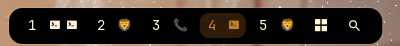
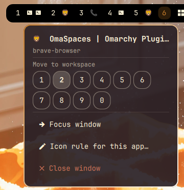

# Omaspaces

Configurable Hyprland workspace indicators for the [Omarchy](https://omarchy.org/) bar: each pill shows the workspace number (and an optional name) plus a clickable glyph for every open window's app. Right-click to move or close windows, and save app layouts as **profiles** you can relaunch in one click.


## What you see



- **Pills** — one per workspace, numbered, holding a small glyph for each open
  window's app (capped, with a `+N` overflow past the limit).
- **Active state** — the workspace shown on that bar's monitor gets a soft
  background fill in your accent color; urgent workspaces get a red fill.
- **Workspace number** — click to focus the workspace; right-click to name
  it (e.g. `1 dev`) or open the icon rules editor.
- **App icons** — click an icon to focus that exact window; right-click it
  for a menu to move it to another workspace, close it, or add an icon rule
  for its app; middle-click closes it.
- **Scroll** over the pills to step through open workspaces, one step per
  wheel notch (touchpads are smoothed so a swipe doesn't fly past several).
- **Special workspaces** — a scratchpad that holds windows gets its own
  outlined pill with a window count; click it to show or hide it.
- **Profiles button** — opens [workspace profiles](#workspace-profiles).



## Requirements

- Omarchy (Quattro) running on Hyprland
- A Nerd Font installed and set as the bar font, so app glyphs render

## Installation

```sh
omarchy plugin add https://github.com/DanielLob-o/Omaspaces.git --enable
omarchy bar put lobo.omaspaces --section center
```

Omarchy's built-in `omarchy.workspaces` widget is often already on the bar
too, which means you'll see two workspace indicators side by side until you
disable it:

```sh
omarchy plugin disable omarchy.workspaces
```

## Configuration

Omarchy doesn't have a settings-panel GUI for bar widgets yet — set a key
with `omarchy bar set lobo.omaspaces <key> <value>`, which writes it to the
widget's entry in `~/.config/omarchy/shell.json` (hand-editing that file
works too, and hot-reloads on save). Booleans and numbers need `--json`, or
they're written as plain strings — which for a boolean means `false` (the
string) is truthy, silently turning the setting *on*:

```sh
omarchy bar set lobo.omaspaces compact true --json
omarchy bar set lobo.omaspaces workspaceCount 6 --json
```

| Setting | Key | Description |
|---|---|---|
| Show app icons | `showIcons` | Render a glyph per open window inside its workspace pill |
| Show workspace numbers | `showNumbers` | Show the workspace number |
| Base workspace count | `workspaceCount` | Workspaces always shown, even empty |
| Highest workspace shown | `maxWorkspaceId` | Ceiling for extra workspaces that appear once occupied |
| Hide empty extra workspaces | `hideEmpty` | Drop (rather than dim) empty workspaces above the base count |
| Max icons per workspace | `iconLimit` | Caps icons per pill before collapsing into a `+N` |
| Active color | `accentSource` | `Accent`, `Urgent`, or `Foreground` palette role, shown as a soft background fill on the active workspace (urgent workspaces are always red) |
| Compact spacing | `compact` | Tighter padding/gaps between pills |
| Show tooltips | `showTooltip` | Hover tooltips: a workspace number lists its window titles, an app icon shows its window's title |
| Custom icon rules file | `iconOverridesPath` | Path to the JSON file the icon rules editor (below) reads and writes; defaults to `~/.config/omarchy/omaspaces-icons.json` |
| Show special workspaces | `showSpecial` | Pill for each non-empty special (scratchpad) workspace |
| Show profiles button | `showProfiles` | The button that opens workspace profiles |
| Workspace names | `workspaceNames` | Object mapping workspace id to a name, e.g. `{"1": "dev"}`; editable by right-clicking a number |
| Profiles file | `profilesPath` | Where profiles are stored; defaults to `~/.config/omarchy/omaspaces-profiles.json` |

Workspace names can also be set from the command line:

```sh
omarchy bar set lobo.omaspaces workspaceNames '{"1": "dev", "3": "chat"}' --json
```

## Icons

### Built-in icon rules

App-to-icon rules live in `IconRules.js`, split into a small `titleRules`
list and a larger `classRules` list (matched and cached by window class).
Title rules only apply to browser windows, where the class alone can't tell
tabs and web apps apart; a terminal whose title mentions "github" keeps its
terminal icon. Add or reorder entries there and save; the shell hot-reloads
plugin QML on change.

### Adding your own icons

Open the icon rules editor from the bar, no file editing required:
right-click an app icon and choose **Icon rule for this app…** (the pattern
comes prefilled with that app's class), or right-click a workspace number
and choose **Icon rules…**. Then:

1. Pick an app from the dropdown (populated from your currently open
   windows), or just type a pattern by hand.
2. Paste an icon glyph. Grab one from the
   [Nerd Fonts cheat sheet](https://www.nerdfonts.com/cheat-sheet) — search
   for the app name, click a glyph to copy it.
3. Click **Add**. It applies immediately and is saved to the "Custom icon
   rules file" path above.


Existing rules are listed below the form with a **✕** to remove them. Since
these are checked *before* the built-in rules, the editor also doubles as
the way to replace a built-in icon you don't like.

#### Editing the file directly

The editor is just a UI over a plain JSON file, so you can also hand-edit
it (or manage it with your own tooling/dotfiles):

```json
[
  { "match": "claude-code|claude", "icon": "" },
  { "match": "my-internal-app", "icon": "󰀻" }
]
```

Each entry's `match` is a case-insensitive regular expression tested
against both the window class and title; the first match in the file wins.
The file is watched and re-applied automatically whenever it changes — no
reload or restart needed, whether you edited it by hand or through the
in-widget editor.

If a window's class isn't obvious from the app picker, find it with:

```sh
hyprctl clients | grep -A2 'class:'
```

## Workspace profiles

A profile is a saved app layout, such as "At Work" or "At Home", listing
which apps go on which workspace. Click the profiles button at the end of
the pills to open them.


- **Capture the current layout** saves every open window's app and
  workspace as a new profile.
- **Click a profile** to apply it. Apps that are already open are left
  where they are; only the missing ones are launched, and each new window is
  moved onto its saved workspace as it appears. The status line reports how
  many were opened.
- **The gear** opens an editor: rename the profile, move each app to a
  different workspace with `‹ ›`, remove apps, add an app that's open right
  now, recapture the layout, or delete the profile.
- **+** creates an empty profile to fill in through the editor.


Launch commands are worked out when you capture: the app's desktop entry
when it has one (Omarchy web apps like WhatsApp included), otherwise the
process's own command line. Profiles live in a plain JSON file you can
edit by hand:

```json
[
  {
    "name": "At Work",
    "apps": [
      { "class": "brave-browser", "workspace": 1, "command": "uwsm-app -- gtk-launch 'brave-browser.desktop'" },
      { "class": "com.mitchellh.ghostty", "workspace": 2, "command": "uwsm-app -- gtk-launch 'com.mitchellh.ghostty.desktop'" }
    ]
  }
]
```

`class` is matched against open windows (case-insensitive) to decide
whether an app is already running.

## Removal

```sh
omarchy plugin remove lobo.omaspaces
```

## License

MIT. See [LICENSE](LICENSE).
